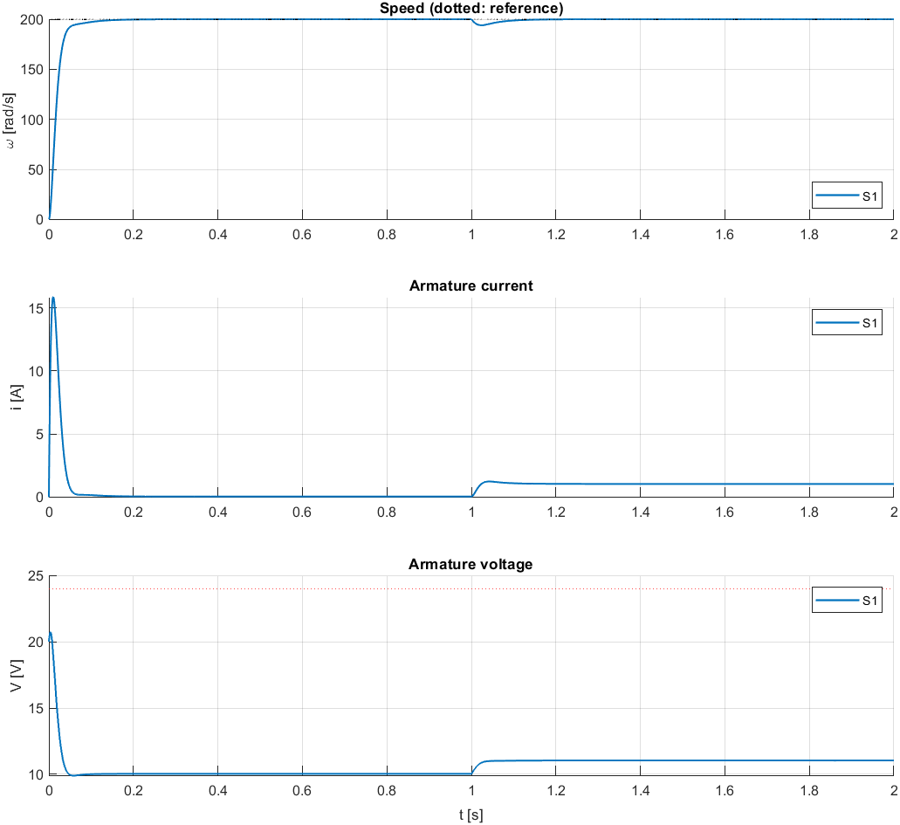
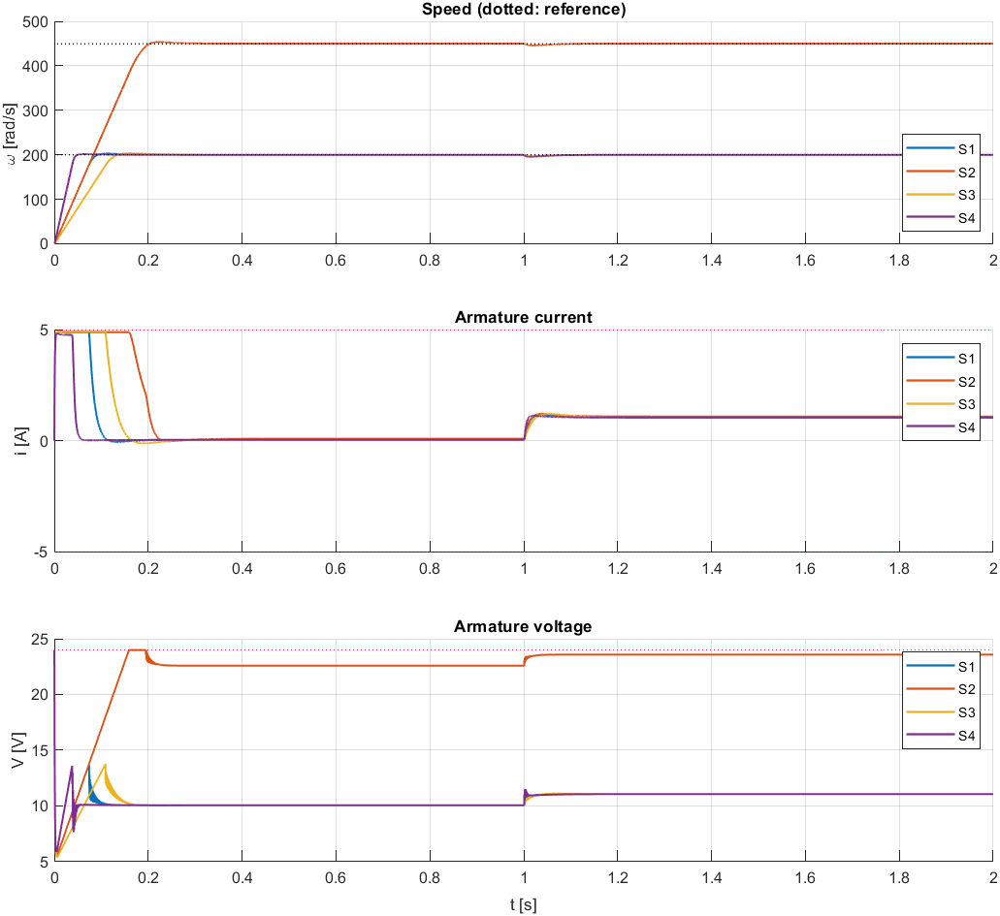
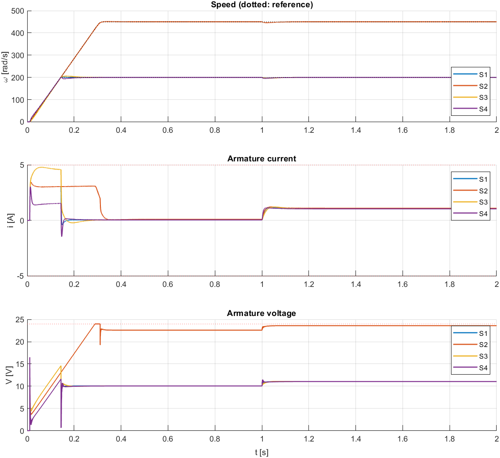

# DC Motor Speed Drive in Simulink

A DC motor speed drive developed in three versions, from a single PI loop to a
cascade drive with current limiting, reference shaping and torque feedforward.
Every model is generated from a MATLAB script and verified by automated
pass/fail tests, so all results can be reproduced from a clean checkout.

**Requirements:** MATLAB and Simulink R2024b (base Simulink only, no extra toolboxes).

## Quick start

```matlab
startup_project   % add project folders to the path
run_all           % build all models, run all tests
```

Reports and plots are written to `results/`. To open a model:
`open_system('dcmotor_drive')` (after `startup_project`).

## Versions

| | v0.1 `dcmotor_pid` | v0.2 `dcmotor_cascade` | v0.3 `dcmotor_drive` |
|---|---|---|---|
| Structure | Speed PI → voltage | Speed PI → current PI → voltage | v0.2 + reference ramp + acceleration feedforward |
| Current limit | none | 5 A | 5 A |
| Controllers | continuous | discrete, 1 kHz / 10 kHz | discrete, 1 kHz / 10 kHz |
| Test scenarios | 1 | 4 | 4 |
| Checks passed | 6/6 | 28/28 | 40/40 |
| Peak start-up current | 15.9 A | 4.9 A | 3.4 A |
| Voltage saturation | none | at every start | 22 ms at the 450 rad/s top end only |

### v0.1 – single PI loop


Meets the speed specification, but the start-up current peaks at 15.9 A,
about 16 times the loaded running current. A speed loop alone cannot limit current.

### v0.2 – cascade control with current limit


The inner current loop holds the current at the 5 A limit in every scenario.
At the limit the motor accelerates at a constant `K·Imax/J` (2500 rad/s² nominal),
seen as straight speed ramps. The 450 rad/s case shows the drive running out of
voltage: only ~2 % headroom remains at full load.

### v0.3 – reference ramp and acceleration feedforward


The setpoint is ramped at 1500 rad/s², below what the current limit allows, and
the feedforward `i_ff = J_nom·(dω_ref/dt)/K` supplies the acceleration current
directly (the 3 A plateau). The PI only corrects errors: with the inertia changed
by ×1.5 or ×0.5 it makes up the mismatch and overshoot stays below 2.9 %.

## Design decisions

- **Cascade control.** The inner current loop protects the motor and driver; the outer loop sets speed.
- **Tuning by pole-zero cancellation.** Current PI: `Kp = ωc·L`, `Ki = ωc·R` with ωc = 1000 rad/s.
  Speed PI: `Kp = ωc·J/K` with ωc = 100 rad/s and the integral zero at ωc/5.
- **Clamping anti-windup** on both loops. The tests force real voltage saturation to exercise it.
- **Feedforward uses the nominal inertia**, so the inertia scenarios test robustness to model error.
- **Back-EMF feedforward was evaluated and not used.** With a 10 kHz current loop it changed
  no test metric by more than 0.1 %.
- **Setpoint step at t = 10 ms in v0.3.** A Rate Limiter passes its input through at the first
  time step, so a step at t = 0 bypasses the ramp. The ramp-tracking test detected this.

## Known limits

- Above ~400 rad/s the drive is voltage-limited rather than current-limited. The v0.3 report
  includes a load-capability table (0.25 N·m up to 300 rad/s, 0.07 N·m at 450 rad/s).
- The feedforward switches on and off at the ends of the ramp, causing a brief 16.5 V peak and
  a short −1.4 A dip. A jerk-limited (S-curve) reference would smooth both.
- The motor model is linear: no cogging, brush drop, PWM ripple or sensor noise.

## Project structure

```
startup_project.m        add folders to the MATLAB path
run_all.m                build every model and run every test
params/                  all numeric values
  motor_params.m           motor data, scenario, base limits (v0.1)
  cascade_params.m         + cascade gains, sample times, current limit (v0.2)
  drive_params.m           + ramp, feedforward, extra limits (v0.3)
  apply_scenario.m         per-scenario overrides, called by each model's InitFcn
src/                     model generation
  build_pid_model.m  build_cascade_model.m  build_drive_model.m
  lib/                     shared building blocks (motor plant, PI loop, wiring, logging)
tests/                   verification
  test_pid.m  test_cascade.m  test_drive.m
  lib/                     scenario runner, metrics, plotting
models/                  generated .slx files
results/                 generated reports and plots
```

## Conventions

1. Numbers live only in `params/`. Blocks reference them by name (`motor.R`, `ctrl.Kp_w`, …).
2. `build_*` scripts overwrite their model. After editing a model by hand, treat the `.slx` as the source.
3. Every change is followed by its test, and the report is kept with the change.
